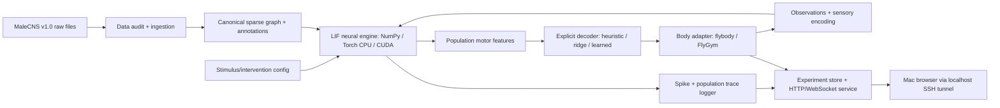

# FlyLab — Claude Code Implementation Specification

> **Version:** 1.0 · **Prepared:** 2026-11-04 (JST)  
> **Status:** Implementation-ready design, **not** an implemented or GPU-validated project  
> **Primary audience:** Claude Code Cloud Sessions (implementer), human owner (acceptance/review)  
> **Mission:** Use the real *Drosophila* MaleCNS v1.0 connectome to build a reproducible, inspectable GPU neural simulation and, in a separate research phase, test an explicit interface to a virtual fly body.

---

## 0. EXECUTION DIRECTIVE — READ THIS FIRST

**You are the lead research software engineer. Implement, do not merely summarize this specification.** Work incrementally in a new, independently licensed `flylab` repository, using existing projects as references or properly attributed dependencies. **Do not silently fork and transplant implementation code without checking license terms.**

**Your priorities, in order:**

1. Produce reproducible, testable scientific software; no fabricated biological claims or measurements.
2. Deliver a working CPU-only vertical slice before writing GPU-specific features.
3. Make an NVIDIA RTX 5070 (12 GB VRAM; Blackwell `sm_120`) a supported **locally verified** target; do not claim that cloud CI has tested it.
4. Treat MaleCNS connectome, neural dynamics, physical body and UI as **independent, replaceable modules**.
5. Build an experimentally useful closed-loop demonstration **only after** the neural engine and body backend pass separate acceptance gates.
6. Use focused pull requests, tests, benchmarks, an explicit uncertainty register and scientific audit.

**At the start of each session:** inspect the repository and existing issues/PRs; identify which milestone is incomplete; write a short execution plan; make code changes; run applicable tests; record results and limitations; open or update a focused PR. Never assert a successful run without its execution log.

**Do not wait for a long prose discussion.** If information is missing, isolate it in `docs/OPEN_QUESTIONS.md`, choose a safe and reversible default, implement the independently testable parts and explicitly state the blocker.

**Cloud ↔ home GPU boundary:** Anthropic's cloud session cannot be assumed to reach the owner's Tailscale network or SSH endpoint. Write/test in the cloud on synthetic fixtures; send changes via GitHub; have the user explicitly run GPU smoke tests on their own trusted host over SSH. Do not expose public SSH or deploy code automatically to the host. Do not request or store SSH keys, Tailscale authentication keys, neuPrint tokens or user secrets in the repository or Claude transcripts.

**Mandatory source audit:** Before adopting any precise value, dependency, dataset schema, repository code or paper-derived parameter, check its upstream primary source or real installed environment. This design is a starting specification, not a substitute for evidence.

---

## 1. Scientific intent and truth boundaries

### 1.1 Core research question

Can a simple, source-traceable spiking neural network built on the **real MaleCNS v1.0 directed connectome** propagate experimentally motivated inputs, respond to controlled neural interventions, and expose motor-related population activity in a reproducible manner on an RTX 5070? If yes, can a **clearly identified, engineered** decoder map those responses into a fly-body physics simulator in a closed loop?

### 1.2 What this is and is not

- **Empirical anatomy:** neuron identities, annotated connections, and any supplied transmitter predictions are derived from the cited MaleCNS data and require dataset provenance.
- **Modeled dynamics:** LIF membrane time constants, synaptic efficacy, delay, threshold, and stimulus transduction are **not** entirely measured per neuron; they must be documented as literature-derived or assumed.
- **Engineering interfaces:** mapping motor-related activity to body actuators is **not** automatically recoverable from the connectome. Any heuristic, regression, or learned policy must be named, configured, compared and ablated.
- **Validation:** the Shiu et al. (2024) study validates particular predictions of a **different, female-brain** whole-brain model; it **does not** validate arbitrary MaleCNS outputs or an independently created body decoder.
- **No claims of consciousness, a complete biological brain, faithful virtual fly behavior, or true evolutionary adaptation** absent direct experimental evidence.

### 1.3 Evidence types required in code/docs

Every dataset field, model parameter, mapping and claim must have exactly one label:

| Label | Meaning | Example |
|---|---|---|
| `EMPIRICAL` | Directly from measured/published dataset | Janelia body ID and connection count |
| `LITERATURE_DERIVED` | Adopted from published method with citation and version | A documented LIF parametrization |
| `ASSUMED` | Chosen without direct measurement for target neuron | Constant delay of 1 ms |
| `ENGINEERED` | Software interface or arbitrary action transform | Motor population → actuator mapping |
| `LEARNED` | Fit from specified optimization or data | Ridge decoder fit on motion data |
| `UNKNOWN` | Not established | True synaptic conductance of a particular pair |

**Research metadata cannot be silently overridden by UI selections or convenience constants.**

---

## 2. Operating environment and initial audit

### 2.1 Known owner hardware and access

- **GPU host:** desktop with NVIDIA RTX 5070 12 GB, Ryzen 7 9700X, about 32 GB system RAM; Windows and a separate Linux Mint installation have previously been used. **Do not assume which OS is currently booted**, or that Linux Mint, Windows/WSL2, and CUDA have identical configuration.
- **Storage:** Linux Mint has previously been installed on a 500 GB NVMe. Verify free space before pulling datasets/images; never reformat, repartition or overwrite data.
- **Client:** MacBook Air; SSH over an existing Tailscale private network is preferred.
- **Orchestration:** Claude Cloud Sessions via GitHub. Any actual GPU execution happens on the owner's machine, not in the cloud session.

### 2.2 Supported platform path

1. **Preferred without unnecessary OS changes:** existing **Linux Mint** if host drivers and NVIDIA Container Toolkit work. Avoid reinstalling the owner's OS merely to match a reference environment.
2. **Known-reference alternative:** native **Ubuntu 24.04 LTS** is easier to reproduce in official container-toolkit documentation; changing OS requires explicit user decision.
3. **Alternative:** Windows 11 + **WSL2 Ubuntu**. Use the Windows NVIDIA GPU driver; **do not install a second Linux display driver into WSL2**.
4. macOS is a remote client, **not** the RTX execution host.

### 2.3 Hardware preflight (run on host, no destructive actions)

```bash
uname -a
cat /etc/os-release || true
nvidia-smi
nvidia-smi --query-gpu=name,driver_version,memory.total --format=csv
free -h
df -h
docker --version || true
python3 --version
command -v tailscale && tailscale status || true
```

On Windows/WSL2, run `wsl --status` in PowerShell and `nvidia-smi` inside the selected WSL distro. Save sanitized output under `artifacts/system/`; **never commit hostnames, network addresses, users, tokens or secrets without redaction**.

**Preflight deliverable:** `docs/ENVIRONMENT_AUDIT.md` containing actual verified host OS, driver, available RAM/storage, chosen deployment path and unresolved compatibility risks. If host inspection is impossible from the cloud, provide a script and leave real fields `UNVERIFIED`.

### 2.4 GPU software constraints

- RTX 5070 = Blackwell compute capability 12.0 (`sm_120`). Choose a PyTorch binary with actual `sm_120` support; **CUDA 11.x builds are not suitable**. Blackwell support began with CUDA 12.8; a later compatible version is acceptable after checks.
- Keep the host GPU driver and container CUDA runtime separate where practical; validate compatibility, rather than choosing a version only because it is newest.
- Verify installation using official PyTorch selector and a real CUDA kernel execution on the target device. Pin tested versions and Docker image digest after successful host validation.
- The older `flybody` instructions contain CUDA 11.8 examples; do **not** impose those on the Blackwell neural runtime.
- Standard MuJoCo physics is generally CPU-side; GPU-accelerated rendering does **not** imply GPU physics. MJWarp/FlyGym GPU physics are a **separate measured compatibility experiment**, not an automatic assumption.

Run on the GPU host after environment installation:

```bash
python - <<'PY'
import torch
print('torch_version=', torch.__version__)
print('torch_cuda_build=', torch.version.cuda)
print('cuda_available=', torch.cuda.is_available())
if not torch.cuda.is_available():
    raise SystemExit('CUDA unavailable')
print('gpu_name=', torch.cuda.get_device_name(0))
print('capability=', torch.cuda.get_device_capability(0))
assert torch.cuda.get_device_capability(0) == (12, 0)
x = torch.randn((1024, 1024), device='cuda')
y = x @ x
assert bool(torch.isfinite(y).all().item())
torch.cuda.synchronize()
print('smoke_test=PASS')
PY
```

Docker GPU validation must be a separately logged host test; do not hardcode a hypothetical image tag that may have disappeared. Follow the official NVIDIA Container Toolkit instructions to install and configure runtime, then test with a **confirmed existing** `nvidia/cuda` image.

---

## 3. Primary sources and reference code

Do **not** automatically combine incompatible datasets, model generations or anatomical types.

| Item | Intended role | Critical distinction |
|---|---|---|
| [MaleCNS v1.0](https://male-cns.janelia.org/) / [download](https://male-cns.janelia.org/download/) / [release notes](https://male-cns.janelia.org/release/) | Primary male whole-CNS connectome and metadata | v1.0 released **2026-06-08**; includes brain and VNC; data licensed CC-BY |
| [Google Research MaleCNS report](https://www.research.google/blog/a-connectomics-milestone-mapping-the-complete-male-fruit-fly-brain/) | Project background | Google **Research** collaboration; not equivalent to a Google DeepMind brain simulator |
| [MaleCNS Cell paper](https://research.google/pubs/sexual-dimorphism-in-the-complete-connectome-of-the-drosophila-male-central-nervous-system/) | Scientific foundation and counts | Check journal definitions and filtering before equating published and code neuron counts |
| [Shiu et al., Nature 2024](https://www.nature.com/articles/s41586-024-07763-9) | LIF method and validation precedent | Based on the **female** brain; not a direct validation of this male model |
| [HEREISCB/flybrain](https://github.com/HEREISCB/flybrain) | Closest reference implementation for MaleCNS LIF and viewer | Claims ~167,106 neurons; **audit actual code, license, provenance and baseline results before reuse** |
| [Eon fly-brain](https://github.com/eonsystemspbc/fly-brain) | Alternative simulator/backends and benchmark ideas | Primarily FlyWire **female** connectome; not drop-in MaleCNS implementation |
| [TuragaLab/flybody](https://github.com/TuragaLab/flybody) / [Nature 2025](https://www.nature.com/articles/s41586-025-09029-4) | Anatomical MuJoCo body and locomotion environments | Learned locomotion controller ≠ empirical neural connectome |
| [FlyGym / NeuroMechFly](https://github.com/NeLy-EPFL/flygym) | Alternative body backend and possible GPU physics | API, performance and version compatibility require separate test |
| [NVIDIA CUDA architecture](https://docs.nvidia.com/datacenter/tesla/drivers/latest/cuda-toolkit-driver-and-architecture-matrix.html) | `sm_120` / driver compatibility | Architecture and runtime must both be compatible |
| [PyTorch installation](https://pytorch.org/get-started/locally/) / [NVIDIA Container Toolkit](https://docs.nvidia.com/datacenter/cloud-native/container-toolkit/install-guide.html) | Reproducible GPU setup | Pin only after validating on target GPU |
| [Tailscale SSH](https://tailscale.com/docs/features/tailscale-ssh) / [recent fixes](https://tailscale.com/blog/tailscale-ssh-findings-fixes) | Private remote administration | Update clients, enforce authorization; no public SSH |

**Important historical correction:** MaleCNS v1.0's official release was **June 8, 2026**, not September 3. September relates to a publication/announcement; cite the release page when describing dataset availability.

**Count discrepancy:** publication reports **166,691** neurons while a third-party `flybrain` README describes **167,106**. Do not merge these as one verified denominator. Create `DATASET_COUNT_RECONCILIATION.md` tracing filtering, annotation category and graph node choices, and treat mismatched counts as a data audit item.

**Data volume planning:** the official connection-weight Feather file is roughly **1.1 GB** on disk (confirm exact available file and size when downloading). Other synapse-level tables are much larger and do not belong wholly on a 12 GB GPU for the MVP. On-disk compressed size ≠ resident sparse-GPU memory.

---

## 4. Requirements and non-goals

### 4.1 MUST for first research MVP

- Import and hash a specific MaleCNS dataset release; track its source and CC-BY attribution.
- Preserve `body_id` and neuron annotations in a deterministic `body_id → index` map.
- Build directed, weighted **sparse** connections; define graph orientation and semantics explicitly.
- Implement a small tested NumPy reference LIF simulator, then PyTorch CPU and CUDA backends.
- Support controlled stimulus, silencing and synapse-removal interventions with meaningful baseline comparisons.
- Export streaming or bounded spike records and summary statistics; avoid recording a dense `N × T` spike matrix unnecessarily.
- Save complete experimental provenance, parameters, seeds, Git commit, dataset checksum and environment versions.
- Provide an SSH-accessible, private **read-only default** dashboard and an explicit controlled experiment-run endpoint.
- Run CPU tests in GitHub CI; provide scripts and result templates for local GPU testing.
- Provide scientific evidence labels and known limitations in UI and experiment output.

### 4.2 SHOULD after baseline is validated

- Headless `flybody` backend and separate motor-decoder evaluation.
- Closed-loop sensory input → MaleCNS → motor decoder → body → sensory feedback.
- Alternative FlyGym backend; compare physics steps/s and fidelity instead of claiming GPU acceleration by default.
- Sparse kernel profiling and conditional optimization (PyTorch sparse, custom kernels/Triton) only after verified baseline.
- Cross-backend regression tests, stimulus-response plots, neuron inspectors, population activity heatmaps and playback.

### 4.3 Explicitly OUT OF SCOPE for MVP

- Reconstructing complete synapse biophysics for every neuron.
- Biological claims that the brain has subjective experience or reproduces live fly behavior.
- Online reinforcement learning of an end-to-end whole-brain model without a validated baseline.
- Full flight control, real-time hardware robot control, public web hosting, arbitrary user-supplied code execution.
- Automatically making irreversible changes to the owner's OS, bootloader, network or home automation.

---

## 5. Architecture and boundaries



**Hard dependencies:** data importer does not import MuJoCo; neural engine does not import frontend or SSH libraries; body adapter does not own graph parsing; API does not run arbitrary shell commands.

### 5.1 Reference layout (Claude may refine while preserving boundaries)

```text
flylab/
  CLAUDE.md                         # brief pointer to this specification
  docs/
    IMPLEMENTATION_SPEC.md          # this file
    SOURCES_AND_LICENSES.md
    ENVIRONMENT_AUDIT.md
    DATASET_COUNT_RECONCILIATION.md
    MODEL_ASSUMPTIONS.md
    SCIENTIFIC_LIMITATIONS.md
    OPEN_QUESTIONS.md
    BENCHMARK_PROTOCOL.md
    SECURITY.md
  src/flylab/
    data/                          # loaders, schema, checksum, indexing
    neural/                        # lif_numpy, lif_torch, cuda backend
    experiments/                   # stimulus, lesions, metrics, replicates
    embodiment/                    # interface, flybody, flygym, decoders
    api/                           # HTTP + WebSocket, auth, jobs
    cli/                           # explicit entrypoints
    provenance/                    # versions, hashes, manifests
  web/                              # TypeScript UI (deferred until core works)
  configs/
    synthetic.yaml
    male_cns_baseline.yaml
    example_olfactory.yaml
  scripts/
    audit_host.sh
    setup_local_gpu.sh
    run_local_gpu_smoke.sh
  tests/
    fixtures/                      # miniature synthetic graph only
    unit/
    integration/
    gpu/                           # skipped in generic CI
    scientific/
  benchmarks/
  .github/workflows/
  pyproject.toml
  uv.lock or requirements.lock     # choose and pin one reproducible workflow
  Dockerfile
  compose.yaml
  .env.example
  .gitignore
  README.md
```

**License and dataset policy:** keep raw bulk data and API tokens out of Git (`data/raw/`, `.env`, `artifacts/`, experiment binary outputs ignored). Record URL, access timestamp, dataset license, raw SHA256 and upstream revision. Inspect third-party code licenses **before** vendoring, adapting or publishing derivative work; attribute all external dependencies.

---

## 6. Canonical data contracts

### 6.1 Dataset graph representation

Use an indexed directed edge table with **explicit source → target orientation**. Never create a dense `N × N` float adjacency matrix.

```text
Neuron table:
  idx: int32 [0, N)     stable deterministic dense index
  body_id: int64        original empirical ID
  cell_type: string?    nullable, source-tagged
  region: string?       nullable, source-tagged
  transmitter: string?  nullable; prediction != certainty
  provenance: enum     EMPIRICAL / UNKNOWN

Edge table:
  src_idx: int32
  dst_idx: int32
  synapse_count: int32 or int64
  effective_weight: float32
  sign: int8?           unknown allowed; never silently assign +/-
  delay_steps: int32    literature-derived/assumed, explicitly recorded
  weight_provenance: enum
```

**Definitions:** a source synapse count is **not** identical to a unique directed edge count. Store both. Validate duplicate source-target pairs explicitly; if aggregated, record the exact aggregation rule and whether direction was retained. Do not assume a neurotransmitter label directly determines a unique postsynaptic sign; unknown/modulatory cases require documented handling and sensitivity analyses.

### 6.2 Importer CLI contract

The following is a **target interface for Claude to implement**, not a currently existing tool:

```bash
flylab data fetch --dataset male-cns:v1.0 --dest data/raw/
flylab data inspect --raw data/raw/ --report artifacts/data_audit.json
flylab data prepare --raw data/raw/ --out data/processed/male-cns-v1.0/
flylab data verify --processed data/processed/male-cns-v1.0/
```

- Fetch must use the **actual links/formats** published by the official download page; never invent a URL or assume cloud bucket credentials.
- If downloading requires credentials or a token, request user-side authorization and support offline/manual import. Never send tokens to CI logs.
- `prepare` emits `neurons.parquet`, `edges.parquet`, `id_map.parquet`, `graph.npz` or equivalent efficiently loadable arrays, `manifest.json`, `checksums.sha256`.
- `verify` reports node counts, edge counts, synapse totals, unknown IDs/signs, min/max indices, source file hashes and unexpected duplicates. Do not hard-fail solely because a third-party README's neuron count differs; reconcile the definitions.

---

## 7. Neural simulation engine

### 7.1 Baseline LIF model

Define the actual numerical scheme and its parameterization in `MODEL_ASSUMPTIONS.md`. Example continuous-time neuron model:

\[
\tau_i\frac{dV_i}{dt}=-(V_i-V_{\mathrm{rest},i}) + R_i I_{\mathrm{syn},i}(t) + R_i I_{\mathrm{ext},i}(t).
\]

Threshold crossing produces a spike and a documented reset/refractory policy. Implement a discrete-step reference version with explicit choices for integration order, current accumulation, spike transmission timing, delay, numerical precision and handling of repeated spikes. Shiu et al. 2024 informs **model design**, but paper constants must be copied only after direct verification of methods/supplementary materials.

### 7.2 Engine contract (Python protocol, illustrative)

```python
class NeuralEngine(Protocol):
    def reset(self, seed: int) -> None: ...
    def step(self, input_current, interventions=None) -> "NeuralStep": ...
    def simulate(self, steps: int, recorder=None) -> "RunSummary": ...
    def checkpoint(self, path: str) -> None: ...
    def restore(self, path: str) -> None: ...
```

`NeuralStep` must include simulation time, sparse spike indices, and inspectable population summaries (not require full N-vector serialization each step). Cross-module payloads must carry explicit physical units (`ms`, `mV` where appropriate), shape, dtype, index convention and schema version.

### 7.3 Sparse GPU computation

Approximate per-edge memory (before library overhead):

- COO packed arrays: `src:int32` + `dst:int32` + `weight:float32` ≈ **12 bytes × E**. Add delays/metadata if held on GPU.
- CSR approximate storage: `col_indices:int32` + `weight:float32` ≈ **8 bytes × E**, plus `row_ptr:int32 × (N+1)`; actual index dtypes/backend allocations may differ.
- Per-neuron `float32` vector: **4 × N bytes** ≈ 0.67 MB for 166,691 neurons, ignoring multiple state buffers.
- **Dense** `float32[N,N]`: roughly **111 GB decimal** — prohibited.

`E` must be measured from the **processed edge table**, not guessed from the biological synapse count (~125 million). Use retained tensor accounting and peak allocation traces to include allocator, temporary and scatter buffers.

Initial propagation candidates:

1. Simple NumPy CPU edge gather/scatter for exact small-graph reference.
2. PyTorch CPU/CUDA gather plus `scatter_add_` (note GPU atomic accumulation is not necessarily bitwise deterministic).
3. PyTorch sparse CSR/COO kernels, only if benchmarks show a meaningful benefit and math matches.
4. Triton/custom CUDA/CUDA Graph **only after profiling**; do not replace proven-correct implementation for hypothetical speed.

**VRAM gate:** run without OOM on 12 GB and keep a **target of ≤10 GiB peak total device memory attributable to FlyLab**, allowing headroom. This is a target, **not a claimed measurement**. Report `torch.cuda.max_memory_reserved()`, `max_memory_allocated()`, NVML/`nvidia-smi` process memory, and any difference; if unavailable, mark unknown. Avoid unbounded `N × T` activity recording and excessively duplicated edges.

### 7.4 CPU↔GPU correctness

- Tiny deterministic graphs: compare NumPy vs PyTorch CPU within stringent tolerances and expected manually derived outputs.
- GPU: compare floating-point states with justified numeric tolerances, and spike metrics with explicitly justified policies near threshold crossings.
- Full network: perform **population/statistical equivalence**, not unrealistic bit-for-bit cross-device spike equivalence.
- If `torch.use_deterministic_algorithms(True)` rejects an operation, log the unsupported operation, provide a safe deterministic fallback for tests and do **not** silently disable guarantees.
- Set reproducibility seeds in Python/NumPy/Torch; record but do not promise complete cross-platform determinism.

---

## 8. Experiment protocol and statistics

### 8.1 Experiment configuration (proposed YAML)

```yaml
schema_version: 1
experiment_id: olfactory_population_stimulation_v1
dataset: male-cns:v1.0
backend: torch-cpu                  # torch-cuda only on verified GPU
dt_ms: 1.0                         # EXAMPLE ASSUMPTION, NOT BIOLOGICALLY VALIDATED
steps: 1000
seed: 42
neuron_selection:
  method: annotated_population
  population_name: PLACEHOLDER_VERIFY_WITH_DATA
stimulus:
  type: injected_current
  onset_ms: 100
  offset_ms: 500
  magnitude: 1.0                   # Must define units and calibration before scientific run
intervention:
  kind: none                       # none | silence_neurons | remove_synapses
recording:
  spike_events: true
  population_rate_bin_ms: 10
```

**WARNING:** placeholders and example values are **not** runnable/validated MaleCNS cell annotations or physiology. Implement explicit schema validation so a nonexistent population cannot be accepted silently.

### 8.2 Intervention semantics

- `none`: matched baseline, same seed, initial conditions and sensory input.
- `silence_neurons`: suppress designated neuron spikes while separately tracking whether membrane integration continues; define whether incoming/outgoing propagation is affected.
- `remove_synapses`: remove a reproducible, selected subset of directed synaptic connections; not equivalent to killing a neuron.
- `stimulate_neurons`: add configured current or forced spikes; these are biologically different interventions and should never share an unlabeled mode.

### 8.3 Scientific analysis

- Minimum validation experiment: synthetic graph with known impulse response, control/stimulus/lesion conditions and expected outcomes.
- For MaleCNS: pre-register a specific sensory population and downstream output **only after confirming annotations**. Use hold-out experimental comparisons where available; do not relabel exploratory output as validation.
- Repeat stochastic conditions with multiple logged seeds; use paired comparison where initial conditions are matched.
- Metrics: firing rate and rate difference, first-spike latency distribution, spike count, response fraction, population PSTH and outcome of the body task (if embodied).
- Report effect sizes, uncertainty intervals (bootstrap/appropriate method), sample count, unit of replication and multiple-comparison method where needed. No cherry-picked single-seed figures presented as scientific evidence.
- Separate benchmark performance outcomes from biological plausibility outcomes.

### 8.4 Run artifact contract

```text
runs/<run_id>/
  config.yaml                  # frozen validated configuration
  manifest.json                # timestamp, backend, host details (redacted), versions
  dataset_sha256.txt
  git_commit.txt
  spikes.parquet               # event rows: time_step, idx, body_id
  population_rates.parquet
  interventions.parquet
  body_state.parquet           # only if body backend active
  metrics.json
  benchmark.json               # only measured fields, null if unmeasured
  checksums.sha256
```

Export should use chunked writers to avoid exhaustion; define units and schema version in every output.

---

## 9. Virtual body integration: research phase, not MVP claim

### 9.1 Body adapter contract

```python
class BodyBackend(Protocol):
    def reset(self, seed: int) -> None: ...
    def action_spec(self) -> "ActionSpec": ...
    def observe(self) -> "BodyObservation": ...
    def step(self, action) -> "BodyStep": ...
    def close(self) -> None: ...
```

First implement `FlybodyBackend` through the **real upstream API** and a headless smoke test. Use `MUJOCO_GL=egl` on compatible Linux systems only after checking EGL is available; provide `osmesa`/non-rendered fallback as appropriate. Confirm action dimension from `env.action_spec()` at runtime. Upstream walking demonstrations report **59 actions**; do not assume that this is invariant across every environment/version.

An example smoke test should reset an environment, sample a valid action from its spec or use a safe zero vector matching the spec, step 100 times, and assert finite observations and no invalid physics warnings; **a zero-action fly may fall or fail to walk, which alone is not a code failure**.

### 9.2 Motor decoder contract

```python
class MotorDecoder(Protocol):
    def decode(self, neural_features, observation, time_ms: float) -> "Action": ...
```

Implement three explicit candidates with provenance:

- **Heuristic:** manually documented population → joint-group mapping; strictly `ENGINEERED`.
- **Linear/Ridge:** learned mapping from precisely documented reference trajectories; `LEARNED`, with train/validation split.
- **Small policy:** optional, trained only with declared objective and ablation; `LEARNED`, **not** evidence that the connectome alone generated locomotion.

The complete path is `sensor encoding → MaleCNS → identified descending/VNC/motor populations → decoder → body action → physics → observations → sensory encoding`. Unmapped neurons and missing sensory transduction must be explicit. Start walking only; do not prematurely target flight.

### 9.3 Closed-loop gate

Pass only if:

1. Neural simulator passes its own numerical and intervention tests.
2. Body simulator passes its own 100+ step finite-state tests.
3. Decoder actions match verified action spec, units, bounds and rate.
4. A recorded, repeatable **engineering demo** exists showing the body state changing after input.
5. A corresponding control/ablation demonstrates whether the neural input materially alters the output.
6. The published description says **engineering demonstration**, not 'fully biologically accurate fly walking'.

FlyGym / MJWarp benchmarking is optional after this gate, evaluated as a separate body backend.

---

## 10. API, dashboard and network contract

### 10.1 API (target; implement with FastAPI or justified equivalent)

| Method | Endpoint | Responsibility |
|---|---|---|
| `GET` | `/api/v1/health` | service, engine availability, non-sensitive status |
| `GET` | `/api/v1/datasets` | installed, verified datasets only |
| `POST` | `/api/v1/experiments` | validate config and enqueue bounded job |
| `GET` | `/api/v1/experiments/{id}` | status, provenance, summarized metrics |
| `POST` | `/api/v1/experiments/{id}/cancel` | safe cooperative cancellation |
| `GET` | `/api/v1/experiments/{id}/artifacts` | controlled listing, no arbitrary path reads |
| `WS` | `/api/v1/experiments/{id}/stream` | bounded sampled spike/metric/body events |

Proposed WebSocket JSON message:

```json
{
  "schema_version": 1,
  "type": "population_rates",
  "run_id": "example-run-id",
  "simulation_time_ms": 100.0,
  "bin_ms": 10.0,
  "populations": [{"name": "verified-population", "rate_hz": 12.3}]
}
```

The server streams **downsampled/aggregated data**, not all 166k neuron states every frame. Add backpressure, bounded queues and cancel-safe shutdown. UI should clearly distinguish neural/simulation time from wall time, and display unknown provenance/parameters and GPU verification status.

### 10.2 Security architecture

- Prefer **localhost-only binding** on GPU machine (`127.0.0.1:8765`) with SSH tunnel from Mac:

```bash
ssh -N -L 8765:127.0.0.1:8765 <user>@<tailscale-host>
# On Mac: http://127.0.0.1:8765
```

- Never expose ports `22`, `8765` or Docker daemon to public WAN just to make the demo work.
- Use current patched Tailscale, SSH key-based auth where applicable, least-privilege Linux user and private tailnet ACLs. Tailscale SSH and ordinary OpenSSH over Tailscale are distinct configurations; document the chosen one.
- No `--privileged` containers or host Docker socket mount by default. No host-network mode unless demonstrably necessary.
- Cloud sessions must **not** be given credentials to run on a private GPU host. For GitHub-hosted PRs, local execution is manual and code must be reviewed first.
- No automatic GitHub Actions self-hosted runner for unreviewed/untrusted PR code. No shell execution endpoint in API.
- API must validate payload lengths, experiment quotas, path handling and job concurrency; add an explicit allowlist for host-side experiment configuration.

---

## 11. Benchmark design and acceptance gates

### 11.1 Measurements (never pre-fill)

Record: GPU model/CC, driver, CUDA runtime, PyTorch version, host OS/kernel, CPU, RAM, dataset version/hash, graph nodes, unique edges, synapse totals, mean active fraction, time step, seed, numerical dtype, wall-clock time, neural seconds simulated, steps/s, events/s, host RAM peak, allocated/reserved GPU memory, and `nvidia-smi` process peak if available. Use synchronized CUDA timings with warm-up and multiple repeats, and report distribution rather than a single best case.

### 11.2 Milestone-level definition of done

| Milestone | Objective acceptance criteria | GPU required? |
|---|---|---|
| **M0 Environment** | Host audit script works; data and secrets ignored; CI runs Python lint/type/unit tests; planned GPU image/build identified without fake compatibility claim | No |
| **M1 Dataset** | Official files imported/hashed; stable IDs; no dangling edge indices; counts and discrepancy reconciled/documented; low-memory pipeline tested | No |
| **M2 Neural CPU** | Hand-checkable tiny-network results pass; config/stimulus/silence/lesion work; artifact schema validated; reproducibility tested | No |
| **M3 CUDA** | Local RTX 5070 detects `sm_120`; full graph fits 12 GB; 100 ms and 1 s synthetic/full-network runs finish without OOM/NaN; actual memory/timing logs retained | **Yes, local host** |
| **M4 Scientific** | At least one traceable sensory population, matched baseline + intervention, control comparison, repeated runs, uncertainty reporting and caveat-rich report | Prefer GPU for full graph |
| **M5 Body** | Headless flybody import/step; verified action spec; 100 valid finite physics steps; independent body smoke logs | CPU sufficient initially |
| **M6 Closed loop** | Explicit decoder; 1 repeatable neural→body demo; ablation and logged transformations; no biological validity overclaim | Host recommended |
| **M7 Dashboard** | localhost-only interface; bounded WebSocket; start/stop experiment; view rates/lesions/embodied replay; security checks | No for UI mock |

**Failure behavior:** if full graph does not fit/finish on RTX 5070, preserve the scientific CPU reference and offer a tested smaller annotated subcircuit with a clear 'subcircuit' label. Do not quietly drop nodes and continue claiming a full-CNS simulation. Capture profiling evidence and make performance optimization its own PR.

---

## 12. Claude Code delivery plan: narrow PRs and concurrency

Cloud sessions may work in parallel **only after the core data/API contracts in this specification are respected**. Avoid multiple sessions editing the same files/branch. Each PR should be independently testable and contain a result summary and explicit items not run.

| PR | Scope / owner | Must produce | Dependencies |
|---|---|---|---|
| PR-00 | Repository + CI + source audit | package skeleton, locks strategy, synthetic fixture, pytest/mypy/ruff, docs/source/license audit | None |
| PR-01 | MaleCNS importer | verified source metadata, hashes, deterministic ID index, Parquet + sparse graph, reconciliation tests | PR-00 |
| PR-02 | CPU LIF | NumPy reference, torch CPU engine, stimuli/interventions, artifact format, exact fixture tests | PR-00; synthetic graph |
| PR-03 | CUDA backend | GPU engine, bounded memory, local smoke script, performance protocol, CPU/GPU comparison tests | PR-01 + PR-02 |
| PR-04 | Scientific validation | documented paper-derived assumptions, controls/replicates, metrics/plots, uncertainty and limitations | PR-02 (full data needs PR-01) |
| PR-05 | Body backend | flybody headless adapter, version matrix, smoke tests, decoder interface | PR-00 |
| PR-06 | Integration + dashboard | run manager, localhost API, WebSocket, UI, optional closed loop | PR-03–05 |
| PR-07 | Independent audit | correctness/security/provenance review, no false claims, explicit open issues | All preceding |

**Preferred initial parallelization:** PR-01 (data), PR-02 (CPU neural), PR-05 (body compatibility) may advance in separate branches after PR-00. PR-03 cannot honestly claim GPU passed until the owner's hardware logs exist. Run PR-07 as an independent review after substantive code exists, not as a rubber stamp.

### 12.1 Required PR template

```markdown
## What changed
## Sources and assumptions
## Reproduction commands
## Tests executed (exact commands + outputs)
## Tests not executed / hardware missing
## Numerical and biological limitations
## Security and license implications
## Follow-ups and acceptance-gate status
```

---

## 13. Copy/paste master prompt for Claude Cloud Sessions

**Use this when starting a fresh Claude cloud coding session with a GitHub repository containing this Markdown file.**

```text
You are the lead implementation engineer for FlyLab, a research-grade,
reproducible Drosophila neural simulator targeting an RTX 5070 12GB GPU
accessed privately from a Mac through Tailscale/SSH.

Your source of truth is docs/IMPLEMENTATION_SPEC.md (the FlyLab specification).
Read it fully before implementing. Follow its scientific truth boundaries,
module contracts, security policy, source citations, acceptance gates and
PR plan. The document describes a DESIGN, not an already working system.

Start by inspecting this repository, relevant upstream code and primary
sources. Do not assume external dependencies, schemas, CLI commands, CUDA
compatibility, dataset download links or hardware results without checking.

If repository scaffolding is absent, implement PR-00 first. If it exists,
select the earliest unmet milestone and deliver a focused, working PR.

Deliver actual runnable code and tests, not only plans:
- Synthetic miniature test fixtures and CPU CI first.
- Versioned MaleCNS importer with checksums and deterministic body ID map.
- NumPy reference LIF and PyTorch CPU before CUDA.
- CUDA backend designed for sm_120 and <12 GB VRAM, with no dense NxN matrix.
- Reproducible stimuli, silencing, lesions, spike/rate outputs and provenance.
- Separate flybody body backend and explicit motor decoder at later phase.

Cloud sessions must NOT be assumed able to SSH into the private home GPU.
Do not ask for or store any secret credentials. Produce host-side scripts
and a manual GPU verification checklist; any unexecuted local test must be
reported NOT VERIFIED. Never make a public SSH or web service.

No fabricated benchmarks, neuron-type mappings, biological conclusions or
claims of authentic whole-fly behavior. All assumptions must be labeled.
Do not automatically upgrade old flybody CUDA 11.x instructions into an
RTX 5070 environment; verify a Blackwell-compatible PyTorch runtime.

For the chosen PR: implement, run accessible tests, fix failures, write
reproduction instructions, update open questions, and create a PR with
clear pass/fail evidence. Preserve the user's OS/dual-boot configuration.
```

### 13.1 Optional focused task prompt — DATA

```text
Implement PR-01 only, per docs/IMPLEMENTATION_SPEC.md. Audit the official
MaleCNS v1.0 data files and their license, then implement chunked ingestion,
body_id-to-index mapping, source/target directed sparse edge representation,
metadata/checksums, count reconciliation and CPU tests on synthetic fixtures.
Do not invent biological annotations, source links or a preverified count.
Do not modify the GPU host, network configuration or body backend.
```

### 13.2 Optional focused task prompt — NEURAL CPU

```text
Implement PR-02 only: a small and transparent NumPy reference LIF engine
plus PyTorch CPU backend, controlled stimuli, distinct neural silence vs
synapse-lesion modes, deterministic synthetic test graphs, Parquet/JSON
outputs, schema validation and source-tagged model parameters. Derive
biological constants only from verified paper methods, otherwise label
ASSUMED. No full-GPU performance claims and no flybody coupling.
```

### 13.3 Optional focused task prompt — GPU

```text
Implement PR-03 only once CPU reference tests pass. Make the sparse
MaleCNS engine run on verified RTX 5070 sm_120 with a compatible PyTorch
build. No NxN dense matrix. Add host GPU preflight, CPU/GPU comparison,
100 ms / 1 s benchmark entrypoints, peak VRAM/RAM and synchronized timing.
Cloud CI is CPU-only; explicitly mark all host GPU results UNVERIFIED until
user-provided real logs are inspected. Optimize only after correctness.
```

### 13.4 Optional focused task prompt — BODY

```text
Implement PR-05 only: inspect TuragaLab/flybody's actual current API and
license, install/test its headless core separately from the neural CUDA
stack, define BodyBackend and MotorDecoder protocols, implement a verified
walk-environment action_spec smoke test and document compatibility.
Do not claim the 59-dimensional action vector is a biological motor map.
Do not build a closed-loop controller until neural and body gates pass.
```

### 13.5 Optional independent scientific audit

```text
You are an independent critical reviewer of this FlyLab repository.
Review against docs/IMPLEMENTATION_SPEC.md and linked primary sources.
Check: dataset release/count differences, source direction, sparse graph
semantics, neurotransmitter signs, LIF units/timing/threshold, CPU/GPU
numerics, biological validation claims, decoder provenance, license and
security. Require reproducible evidence. Add failing tests or concrete
issues for each material flaw. Do not manufacture success.
```

---

## 14. First local commands after Claude creates PR-00

**Commands below are a workflow template; `flylab` CLI commands only become real after Claude implements them.** Do not paste blind installer scripts or alter the boot configuration.

```bash
# On the RTX workstation: inspect before changing anything
nvidia-smi
cat /etc/os-release
free -h
df -h

# After reviewing/merging the Claude-generated repository changes:
git clone <your-flylab-repository-url>
cd flylab
bash scripts/audit_host.sh

# CPU baseline (once PR-02 exists):
python -m pytest tests/unit -q

# GPU verification (once PR-03 exists, on local RTX 5070 only):
bash scripts/run_local_gpu_smoke.sh
```

Mac access (replace placeholders with real values; SSH daemon and tailnet permissions must already be configured):

```bash
ssh <user>@<tailscale-host> 'nvidia-smi'
ssh -N -L 8765:127.0.0.1:8765 <user>@<tailscale-host>
```

Use a **manual deployment gate**: a human reviews changes from Claude before any local script executes on a machine containing personal data or other services.

---

## 15. Failure modes and fallbacks

| Problem | Required response |
|---|---|
| `torch.cuda.is_available() == False` | Verify driver, installed wheel, host vs WSL2 path, and CUDA compatibility; no GPU claims |
| `no kernel image available` on RTX 5070 | Inspect `sm_120` support and rebuild/choose a supported wheel; do not use a CUDA 11.x binary |
| GPU OOM | Log real memory; eliminate dense/temp duplication; chunk recording; benchmark sparse methods; if still failing label reduced subcircuit honestly |
| Unexpected node counts | Audit source filters, duplicate IDs, annotation classes and auxiliary nodes; do not force a paper number |
| Wrong synaptic polarity | Trace source predictions; preserve unknown; report sensitivity results instead of guessing neurotransmitter effects |
| CPU and CUDA spike mismatch | Inspect scheduling, integration order, reductions, threshold sensitivity and floating precision; use documented test tolerance |
| flybody installation failures | Isolate its Python/MuJoCo environment; test compatible upstream versions; never break proven neural stack |
| Closed-loop body does not walk | Inspect action scale, frequencies, decoder calibration, body state and controls; body failure is not proof the connectome is wrong |
| Cannot SSH from Claude Cloud | Continue GitHub-based development and give local manual verification scripts; do not punch a port into the firewall |
| No trustworthy behavioral validation data | Report an engineering simulation with scientific limitations, not validated behavior |

---

## 16. Final acceptance report Claude must provide

At the end of each milestone, output a concise table with `PASS`, `FAIL`, `BLOCKED`, or `UNVERIFIED`, plus evidence paths for:

1. Exact source datasets, release, hashes, and license acknowledgement.
2. Real imported neuron/edge/synapse totals and reconciliation notes.
3. CPU numerical reference / stimulus / lesion test outcomes.
4. Actual RTX 5070 `sm_120` CUDA execution and measured memory/performance **only if locally run**.
5. Valid body environment and checked action dimensions **only if actually tested**.
6. Full provenance and reproducibility artifacts for every experiment.
7. Control/ablation plots, sample counts, effect sizes and biological caveats.
8. Security checks: localhost-only ports, no leaked secrets, no unreviewed code on home GPU.
9. Outstanding scientific and engineering blockers.
10. Next independently testable PR.

**Definition of success:** A reproducible, inspectable MaleCNS-based neural simulation with controlled interventions that can run on the owner's RTX 5070, with scientific uncertainty and measured performance documented. Connecting activity to flybody is a **separate, explicitly engineered experimental achievement**, not a prerequisite to calling the neural-simulation MVP useful.

---

## Source list (primary and official sources, checked/assembled 2026-11-04)

- Janelia, MaleCNS official release: https://male-cns.janelia.org/release/
- Janelia, data download and neuPrint example: https://male-cns.janelia.org/download/
- Google Research MaleCNS project: https://www.research.google/blog/a-connectomics-milestone-mapping-the-complete-male-fruit-fly-brain/
- MaleCNS main publication: https://research.google/pubs/sexual-dimorphism-in-the-complete-connectome-of-the-drosophila-male-central-nervous-system/
- Shiu et al. (2024), *Nature*: https://doi.org/10.1038/s41586-024-07763-9
- Flybody (TuragaLab): https://github.com/TuragaLab/flybody
- Flybody paper (2025), *Nature*: https://doi.org/10.1038/s41586-025-09029-4
- HEREISCB/flybrain: https://github.com/HEREISCB/flybrain
- Eon fly-brain: https://github.com/eonsystemspbc/fly-brain
- FlyGym: https://github.com/NeLy-EPFL/flygym
- NVIDIA GPU architecture / CUDA matrix: https://docs.nvidia.com/datacenter/tesla/drivers/latest/cuda-toolkit-driver-and-architecture-matrix.html
- NVIDIA Container Toolkit: https://docs.nvidia.com/datacenter/cloud-native/container-toolkit/install-guide.html
- PyTorch install: https://pytorch.org/get-started/locally/
- Tailscale SSH: https://tailscale.com/docs/features/tailscale-ssh
- Tailscale 2026 security advisory: https://tailscale.com/blog/tailscale-ssh-findings-fixes
- MuJoCo headless rendering: https://mujoco.readthedocs.io/en/latest/programming/rendering.html

**Revision policy:** If a cited primary source conflicts with a detail here, document the discrepancy and adopt a verified source-backed correction through a reviewed commit. Never silently edit historical measurement records.
