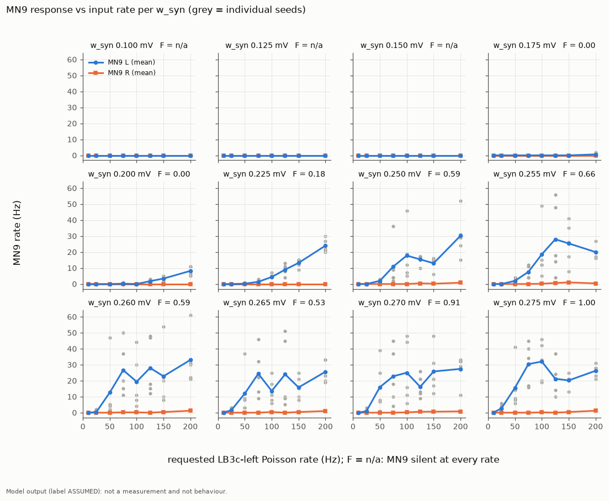
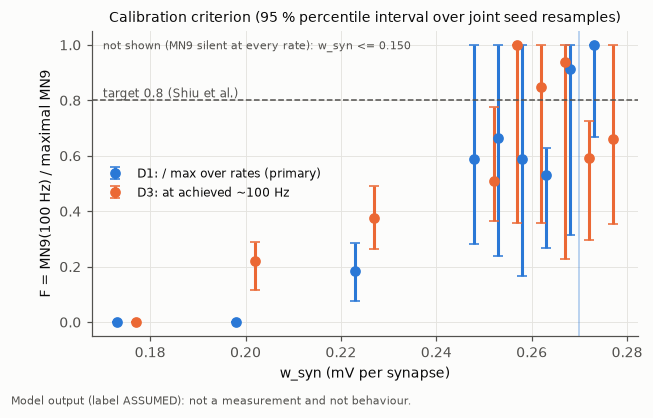
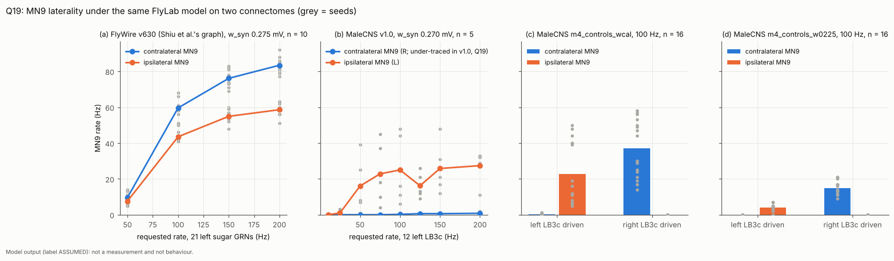
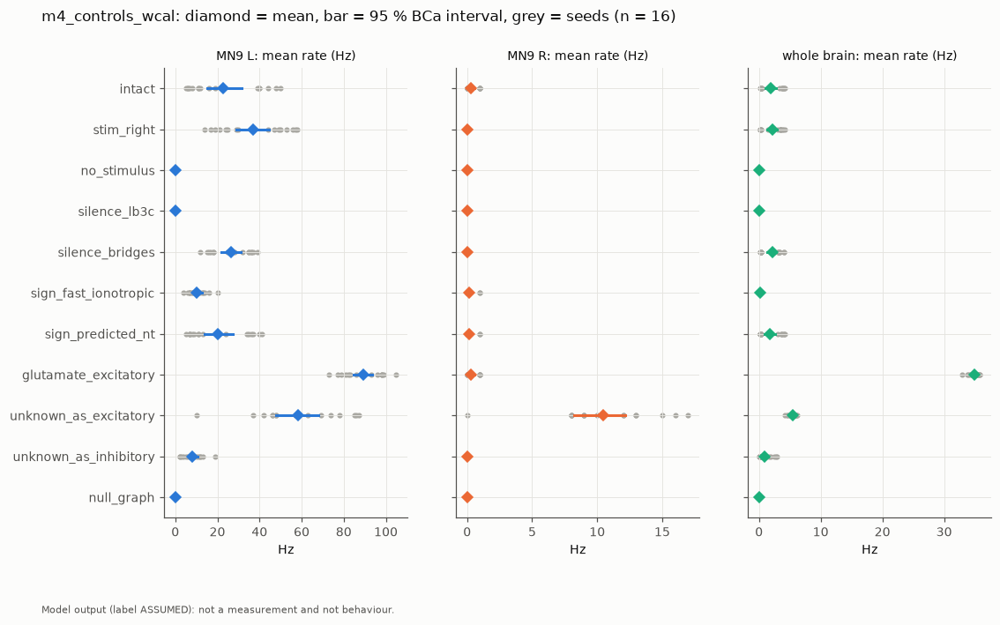
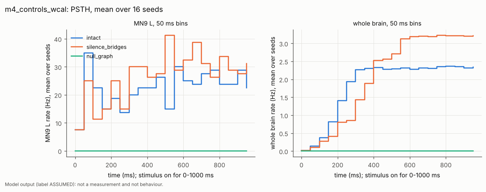
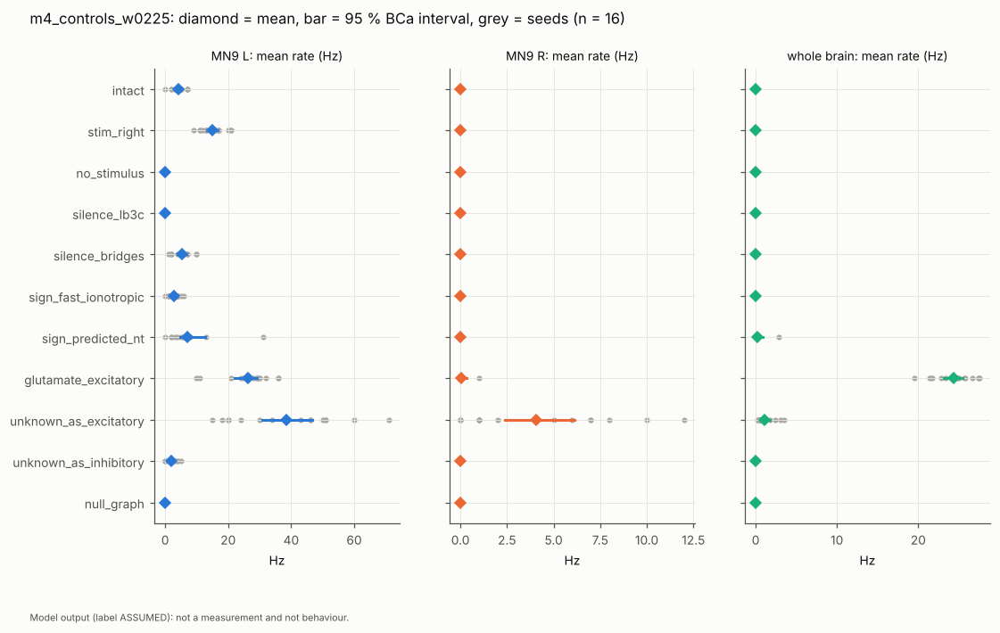
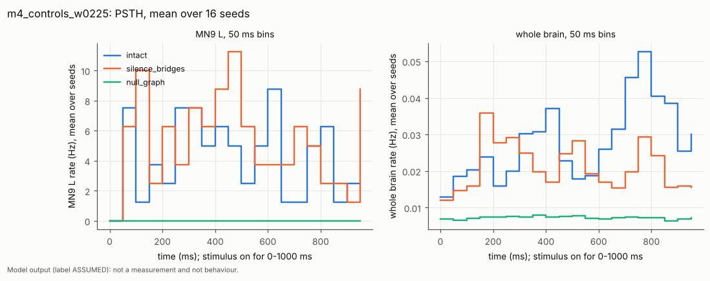
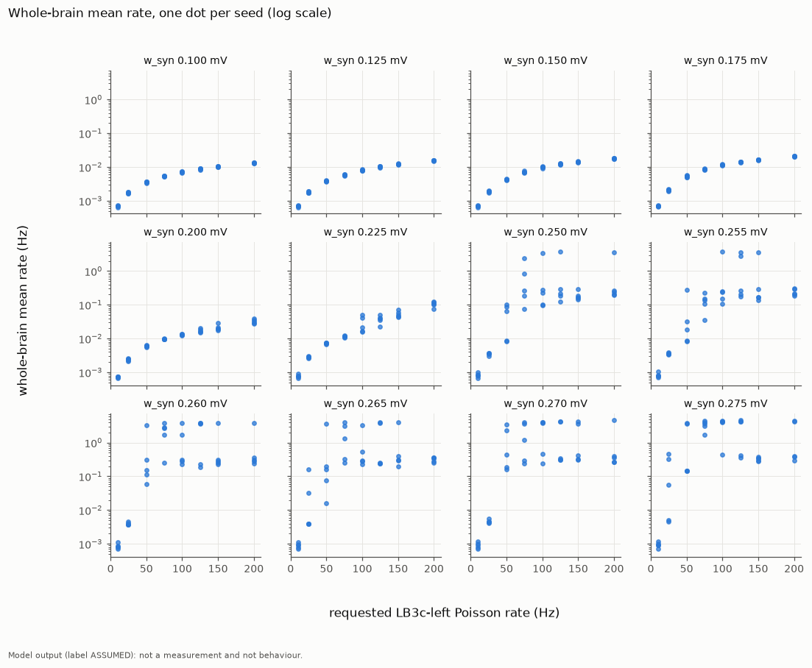

# M4 acceptance report — scientific controls (PR-04)

Report completed: 2026-11-09. This report audits the committed CPU evidence from the earlier
session; it does not report new whole-connectome simulations. §3.1 adds the 0.225 mV control set,
which was run in that same earlier cloud session (members at commit `fcbf98b`, clean tree) and
committed afterwards. Every scientific number in its
tables is copied (rounded for display) from the evidence file named beside that table.
All simulated rates, effects and intervals carry **ASSUMED**, the weakest input label recorded
in the evidence. The fitted parameter alone carries **LEARNED**. **No behaviour is simulated
or claimed; these results are engineering model outputs, not validated physiology.**

## M4 gate (spec section 11.2)

| Criterion | Status | Evidence and scope |
|---|---|---|
| Traceable sensory population | **PASS** | left LB3c body IDs, side rules and graph fingerprint in [Q19 anatomy](evidence/q19-mn9-laterality.json); annotation/type-matching rationale in [Q8 evidence](evidence/open-questions-q8-q13-q14.md) |
| Matched baseline + intervention | **PASS** | `intact`, `silence_lb3c`, `silence_bridges`, seed-paired in [controls](evidence/m4-m4_controls_wcal.json) and [0.225 mV controls](evidence/m4-m4_controls_w0225.json) |
| Control comparison | **PASS** | no stimulus, sign/column/policy variants and degree-preserving null graph in the same controls file; §3 |
| Repeated runs | **PASS** | calibration seeds in [calibration](evidence/m4-calibration-wsyn.json), control seeds in [controls](evidence/m4-m4_controls_wcal.json) and [0.225 mV controls](evidence/m4-m4_controls_w0225.json), cross-check seeds in [FlyWire](evidence/m4-m4_q19_flywire630.json) |
| Uncertainty reporting | **PASS** | bootstrap intervals, paired effects, permutation tests and Holm families are stored in those files; §1–3 |
| Caveat-rich report | **PASS** | §4–5 and [limitations](../SCIENTIFIC_LIMITATIONS.md); provenance gaps retained below |
| GPU scientific runs / biological validation | **UNVERIFIED** | not established by this CPU evidence review; no GPU, animal recordings or body model run here |

Gate scope: the committed evidence satisfies the software/scientific-report deliverables.
This is not a claim that the MaleCNS dynamics reproduce biological or behavioural observations.

<a id="calibration"></a>
<a id="1"></a>

## 1. w_syn calibration

The calibration uses Shiu et al.'s published MN9 saturation criterion, as transcribed with
its source in `by_readout.mn9_left.criterion` of
[m4-calibration-wsyn.json](evidence/m4-calibration-wsyn.json). The source is the
[Shiu et al. Methods](https://doi.org/10.1038/s41586-024-07763-9), on a different, female graph.
FlyLab's operational definitions are **ENGINEERED**. With `M` the seed-mean, whole-run MN9 L
rate, D1 divides `M` at the requested reference rate by the largest `M` over the rate grid;
D2 instead divides by `M` at the highest swept rate; D3 uses D1's denominator but the requested
rate whose achieved stimulus rate is closest to the reference. A zero denominator is undefined.

The committed grid uses 5 seeds, 12 weight levels, 8 requested input rates (10–200 Hz) and
1000 ms runs. It combines coarse and refinement groups; joint seed resampling preserves their
pairing over rates. Intervals are 95% percentile intervals from 10,000 resamples.
The calibration evidence records requested 100 Hz achieving 82.192 Hz and requested 125 Hz
achieving 98.706 Hz. Forced spikes retain the targets' refractory period, unlike the reference
Brian2 input; see Q24. These are two different inputs, not an exact paper replication.

Source for this table: [m4-calibration-wsyn.json](evidence/m4-calibration-wsyn.json),
`by_readout.mn9_left.per_w_syn[].D1`.

| w_syn (mV per synapse) | D1 fraction [95% interval] |
|---|---|
| 0.100 | undefined (MN9 silent) |
| 0.125 | undefined (MN9 silent) |
| 0.150 | undefined (MN9 silent) |
| 0.175 | 0.000 [0.000, 0.000] |
| 0.200 | 0.000 [0.000, 0.000] |
| 0.225 | 0.183 [0.075, 0.284] |
| 0.250 | 0.589 [0.282, 1.000] |
| 0.255 | 0.664 [0.240, 1.000] |
| 0.260 | 0.588 [0.168, 1.000] |
| 0.265 | 0.531 [0.269, 0.629] |
| 0.270 | 0.912 [0.314, 1.000] |
| 0.275 | 1.000 [0.667, 1.000] |

The selected swept D1 level is **0.270 mV, LEARNED**, with fraction **0.912 [0.314, 1.000]**.
D2 selects the same level with fraction **0.912 [0.396, 1.444]**; D3 selects **0.260 mV** with
fraction **0.848 [0.359, 1.000]**. These entries are stored in `selected`, `selected_D2` and
`selected_D3` of the same evidence. D2 can exceed unity because its denominator need not be the
maximum. D1 intervals contain the target at exactly **0.250, 0.255, 0.260, 0.270 and 0.275 mV**;
the intervening **0.265 mV** interval excludes it. A continuous compatible interval would be
misleading. The response is non-monotonic and the fit is weakly identified, especially across
the seed-dependent whole-brain regimes (§4). No new interpolation or density rescaling is
treated here as a measurement. MN9 first responds at **0.175 mV** in this committed grid; there
is no committed grid level at the density-rescaled value discussed in Q16.

The readout is ipsilateral MN9 L because MN9 R is severely input-poor (§2). The value is
calibrated **for this criterion on this graph and input model**, not a physiological synaptic
strength. The preset remains unchanged; controls explicitly override it.





<a id="q19-laterality"></a>
<a id="2"></a>

## 2. Q19: MN9 laterality

The structural audit uses `somaSide`, otherwise `rootSide`, for MaleCNS and the annotation
`side` field for FlyWire. It places Shiu's identified MN9 on the right and the currently
annotated sugar inputs on the left. Missing current annotations remain missing; current
FlyWire annotations are not silently relabelled as the historical graph version.

Source for this table: [q19-mn9-laterality.json](evidence/q19-mn9-laterality.json),
`malecns.results` and `flywire_783.results`, `MN9_*_inputs.input_synapses`.
These are **EMPIRICAL** counts on the stated graphs, separate from simulated firing rates.

| Dataset | MN9 L input synapses | MN9 R input synapses |
|---|---|---|
| MaleCNS v1.0 processed graph | 6,012 | 556 |
| FlyWire v783 structural comparison | 5,886 | 5,579 |

MaleCNS MN9 R is body 16949, annotated `RT Hard to trace`; MN9 L is body 10331, `Roughly traced`.
The same file records 633 R input synapses when all raw presynaptic segments are counted,
including fragments outside the node set. That does not establish the cause of its low input
count or restore its missing connectivity. MN9 R is a poor quantitative laterality readout,
but it is **not completely silent** in the committed replicated data (see §3).

The dynamics cross-check uses the historical FlyWire v630 graph, not the v783 structural
comparison. It uses the same FlyLab forced-spike model, 0.275 mV and 10 seeds.
Source for this table: [m4-m4_q19_flywire630.json](evidence/m4-m4_q19_flywire630.json),
`conditions.*.populations.*.mean_rate_hz`; rates in Hz, mean [95% BCa interval].

| Condition | Ipsilateral MN9 | Contralateral MN9 |
|---|---|---|
| shiu21_r050 | 7.600 [6.600, 8.800] | 9.600 [7.900, 11.300] |
| shiu21_r100 | 43.500 [42.200, 46.200] | 59.600 [56.600, 62.500] |
| shiu21_r150 | 54.900 [52.600, 56.800] | 76.100 [73.400, 79.000] |
| shiu21_r200 | 58.600 [56.000, 60.600] | 83.400 [81.000, 86.400] |
| lb3c9_r100 | 10.000 [7.900, 11.300] | 18.100 [15.600, 19.900] |

At `shiu21_r100`, the stored paired contralateral-minus-ipsilateral effect is
**16.100 Hz [14.100, 19.800]**, `d_z = 3.533`, **Holm p = 0.009765625**
(`population_contrasts` in that file). The qualitative contralateral preference survives the
forced-spike input in this cross-check; exact numerical equivalence to the paper was not tested.

On MaleCNS, right LB3c stimulation raises MN9 L from **22.625** to **37.0625 Hz**. The stored
seed-paired difference is **14.4375 Hz [3.155520, 25.470402]**, `d_z = 0.610171`, but **Holm
p = 1.0** across the controls file's whole comparison family. This is not a confirmed
contralateral preference after multiplicity correction, nor a proof that missing reconstruction
alone explains dataset differences. Source: `comparisons` in
[m4-m4_controls_wcal.json](evidence/m4-m4_controls_wcal.json).

Outside the high whole-brain regime the same comparison is clearer. At 0.225 mV (§3.1; no seed
of `intact` or `stim_right` exceeds 0.073 Hz whole-brain), right LB3c stimulation raises MN9 L
from **4.125** to **14.875 Hz**: seed-paired difference **10.750 Hz [8.750, 13.312]**,
`d_z = 2.229`, **Holm p = 0.002167** across that file's family of 71 tests. Source:
`comparisons` in [m4-m4_controls_w0225.json](evidence/m4-m4_controls_w0225.json). This is a
contralateral preference on MN9 L in this model at this weight, in the direction Shiu et al.
report; it is not a test of MN9 R, and it does not show that reconstruction completeness alone
explains the MaleCNS/FlyWire differences.



<a id="controls"></a>
<a id="3"></a>

## 3. Matched controls and sign sensitivity

The controls use the same 16 seeds and calibrated weight, with requested 100 Hz left LB3c
drive except where the condition changes it. `block_output` silencing blocks outgoing
synaptic effects; forced input events may still be recorded. It is distinct from clamping.
The bridge set is a chosen excitatory disynaptic subset, not the whole sensory pathway.
`null_graph` swaps endpoints with a new seeded degree-preserving shuffle per replicate;
it is an **ENGINEERED** topology control, not a biological alternative connectome.

Source for both tables in this section:
[m4-m4_controls_wcal.json](evidence/m4-m4_controls_wcal.json), `conditions` and `comparisons`.
Rates are Hz, mean [95% BCa interval]; all-equal samples have a degenerate interval.

| Condition | MN9 L | MN9 R | Whole brain |
|---|---|---|---|
| intact | 22.625 [15.188, 31.688] | 0.312 [0.125, 0.562] | 1.856 [0.996, 2.749] |
| stim_right | 37.062 [29.125, 44.438] | 0.000 [0.000, 0.000] | 2.122 [1.331, 2.870] |
| no_stimulus | 0.000 [0.000, 0.000] | 0.000 [0.000, 0.000] | 0.000 [0.000, 0.000] |
| silence_lb3c | 0.000 [0.000, 0.000] | 0.000 [0.000, 0.000] | 0.006 [0.006, 0.006] |
| silence_bridges | 26.625 [22.000, 30.938] | 0.000 [0.000, 0.000] | 2.117 [1.368, 2.803] |
| sign_fast_ionotropic | 10.312 [8.625, 12.562] | 0.125 [0.000, 0.375] | 0.180 [0.162, 0.200] |
| sign_predicted_nt | 20.312 [13.938, 27.500] | 0.125 [0.000, 0.375] | 1.759 [0.901, 2.649] |
| glutamate_excitatory | 89.125 [84.562, 93.562] | 0.312 [0.125, 0.562] | 34.873 [34.417, 35.221] |
| unknown_as_excitatory | 58.375 [47.688, 67.750] | 10.438 [8.250, 12.188] | 5.433 [5.111, 5.681] |
| unknown_as_inhibitory | 8.188 [6.209, 10.688] | 0.000 [0.000, 0.000] | 0.956 [0.530, 1.514] |
| null_graph | 0.000 [0.000, 0.000] | 0.000 [0.000, 0.000] | 0.008 [0.008, 0.009] |

Paired MN9 L effects below compare each condition with `intact`. Confidence intervals are
unadjusted 95% BCa intervals; their exclusion of zero does not imply familywise significance.
`d_z` is the paired standardized effect. Exact two-sided sign-flip tests are Holm-adjusted
across all 71 comparison/contrast tests with a p-value in the file (including other populations).
The FlyWire file has its own family of 5. Statistics settings and fallback/undefined-resample
notes are retained in each evidence record; they must accompany any reanalysis.

| Condition vs intact | Difference Hz [95% interval] | d_z | Holm p |
|---|---|---|---|
| stim_right | 14.438 [3.156, 25.470] | 0.610 | 1.000000 |
| no_stimulus | -22.625 [-31.375, -15.062] | -1.309 | 0.002167 |
| silence_lb3c | -22.625 [-31.688, -15.125] | -1.309 | 0.002167 |
| silence_bridges | 4.000 [-7.688, 14.438] | 0.170 | 1.000000 |
| sign_fast_ionotropic | -12.312 [-22.000, -4.625] | -0.681 | 0.786713 |
| sign_predicted_nt | -2.312 [-12.860, 8.875] | -0.101 | 1.000000 |
| glutamate_excitatory | 66.500 [56.562, 75.250] | 3.470 | 0.002167 |
| unknown_as_excitatory | 35.750 [22.000, 49.192] | 1.245 | 0.014099 |
| unknown_as_inhibitory | -14.438 [-22.750, -6.750] | -0.854 | 0.170898 |
| null_graph | -22.625 [-31.187, -15.062] | -1.309 | 0.002167 |

No stimulus and blocked sensory output remove the MN9 response; the null graph does too.
Silencing the selected bridges does not establish that they are necessary: its interval
includes zero. Changing transmitter columns is also uncertain here. The `fast_ionotropic_v1`
variant changes histamine and modulatory handling together; it does not isolate histamine.
Likewise, unknown-as-excitatory changes all unknown-sign neurons, not histamine alone.
It strongly increases MN9 R relative to its small residual baseline rate.

Glutamate +1 produces a high whole-brain rate in the committed seeds and is a sensitivity bound,
not a validated alternative model. Unknown-sign policies and sign variants alter the regime
and readouts materially. These controls cannot identify the true sign of individual synapses.





<a id="controls-0225"></a>

### 3.1 Regime sensitivity at 0.225 mV

The same 11 conditions and 16 seeds at `w_syn` = 0.225 mV, an **ASSUMED** sensitivity level: the
largest calibration level whose seeds stayed below the whole-brain regime switching (§4), where
the D1 fraction is 0.183 (§1). It is not a calibrated value. Source for both tables:
[m4-m4_controls_w0225.json](evidence/m4-m4_controls_w0225.json), `conditions` and
`comparisons`; rates in Hz, mean [95% BCa interval]; Holm family of 71 tests as in §3.

| Condition | MN9 L | MN9 R | Whole brain |
|---|---|---|---|
| intact | 4.125 [3.188, 5.000] | 0.000 [0.000, 0.000] | 0.028 [0.022, 0.038] |
| stim_right | 14.875 [13.250, 16.812] | 0.000 [0.000, 0.000] | 0.031 [0.029, 0.034] |
| no_stimulus | 0.000 [0.000, 0.000] | 0.000 [0.000, 0.000] | 0.000 [0.000, 0.000] |
| silence_lb3c | 0.000 [0.000, 0.000] | 0.000 [0.000, 0.000] | 0.006 [0.006, 0.006] |
| silence_bridges | 5.312 [4.062, 6.625] | 0.000 [0.000, 0.000] | 0.021 [0.019, 0.024] |
| sign_fast_ionotropic | 2.812 [1.938, 3.625] | 0.000 [0.000, 0.000] | 0.023 [0.018, 0.034] |
| sign_predicted_nt | 7.062 [4.812, 12.625] | 0.000 [0.000, 0.000] | 0.205 [0.023, 0.923] |
| glutamate_excitatory | 26.375 [22.062, 29.250] | 0.062 [0.000, 0.312] | 24.363 [23.150, 25.443] |
| unknown_as_excitatory | 38.562 [30.938, 46.688] | 4.062 [2.375, 6.125] | 1.039 [0.643, 1.698] |
| unknown_as_inhibitory | 1.812 [1.125, 2.625] | 0.000 [0.000, 0.000] | 0.017 [0.014, 0.021] |
| null_graph | 0.000 [0.000, 0.000] | 0.000 [0.000, 0.000] | 0.007 [0.007, 0.007] |

| Condition vs intact (MN9 L) | Difference Hz [95% interval] | d_z | Holm p |
|---|---|---|---|
| stim_right | 10.750 [8.750, 13.312] | 2.229 | 0.002167 |
| no_stimulus | -4.125 [-5.062, -3.188] | -2.102 | 0.003052 |
| silence_lb3c | -4.125 [-5.000, -3.188] | -2.102 | 0.003052 |
| silence_bridges | 1.188 [-0.438, 2.625] | 0.368 | 1.000000 |
| sign_fast_ionotropic | -1.312 [-2.062, -0.625] | -0.879 | 0.231934 |
| sign_predicted_nt | 2.938 [0.812, 7.938] | 0.453 | 1.000000 |
| glutamate_excitatory | 22.250 [18.562, 24.812] | 3.492 | 0.002167 |
| unknown_as_excitatory | 34.438 [26.938, 42.719] | 2.047 | 0.002167 |
| unknown_as_inhibitory | -2.312 [-3.250, -1.312] | -1.162 | 0.035034 |
| null_graph | -4.125 [-5.000, -3.188] | -2.102 | 0.003052 |

What carries over from 0.270 mV: removing the stimulus, blocking the GRNs' output and the null
graph remove the MN9 L response; blocking the selected bridges does not reduce it (interval
includes zero); glutamate +1 raises the whole brain above 19.5 Hz in every seed; making
unknown-sign neurons excitatory is again the only setting with a sizeable MN9 R rate. What
changes: the contralateral advantage on MN9 L survives Holm here (§2), and unknown-as-inhibitory
now lowers MN9 L after correction. MN9 R is 0 Hz in every seed of `intact` at this weight. These
are model outputs at an uncalibrated weight; they bound how much the 0.270 mV conclusions depend
on the regime, they do not replace them.





## 4. High whole-brain regime (Q23)

Pooling seeds conceals a substantial regime change. Source for this table:
[m4-m4_controls_wcal.json](evidence/m4-m4_controls_wcal.json),
`conditions.intact.populations.*.mean_rate_hz.values_by_seed`.
No regime cutoff or post-hoc subgroup statistics have been fitted.

| Seed | Whole-brain mean Hz | MN9 L mean Hz |
|---|---|---|
| 1 | 3.802507 | 16.000 |
| 2 | 0.237876 | 6.000 |
| 3 | 4.036041 | 48.000 |
| 4 | 0.455381 | 11.000 |
| 5 | 4.027888 | 44.000 |
| 6 | 0.300858 | 7.000 |
| 7 | 0.299754 | 6.000 |
| 8 | 0.274613 | 12.000 |
| 9 | 0.300264 | 8.000 |
| 10 | 0.353407 | 5.000 |
| 11 | 4.129928 | 50.000 |
| 12 | 0.304385 | 19.000 |
| 13 | 0.302519 | 11.000 |
| 14 | 3.362076 | 40.000 |
| 15 | 3.732226 | 40.000 |
| 16 | 3.775561 | 39.000 |

The exploratory activity exports identify bilateral Kenyon-cell activity among the leading
MaleCNS types, together with PAM and antennal-lobe local types. They are single-run pointers,
not replicated cell-type tests. [q19-active-types-s1.json](evidence/q19-active-types-s1.json)
records **13,757** spiking MaleCNS neurons, while
[q19-active-types-s2.json](evidence/q19-active-types-s2.json) records **2,320**; each compares
against the same FlyWire seed, with **362** spiking neurons. Their per-type values are summed
rates, not per-neuron rates. The KC→KC density comparison of Q23 is in
[kc-recurrence.json](evidence/kc-recurrence.json) (`scripts/analysis/kc_recurrence.py`;
**EMPIRICAL** counts, with dataset-specific selectors recorded there): **283.9** KC→KC synapses
per Kenyon cell in MaleCNS (4,064 cells; 55.4 % of KC input) against **73.3** in FlyWire v783
(5,177 cells; 40.2 %), a ratio of **3.87**. That is a structural difference, not a causal
explanation of the regime; no causal claim is made. A KC→KC ablation, regime-conditioned
replicates and more seeds remain follow-ups.



## 5. Limitations, provenance gaps and non-claims

- Seeds are input-noise realisations on one fixed graph, not independent animals. Bootstrap
  intervals describe this sampling scheme, not biological uncertainty or model validity.
- Uniform LIF dynamics, sign assumptions, excluded unknown edges, absent fragment compartments,
  omitted plasticity and input-mode differences remain material; see
  [SCIENTIFIC_LIMITATIONS.md](../SCIENTIFIC_LIMITATIONS.md) and Q11/Q17/Q18/Q24.
- Calibration and controls use the same graph and modelling choices. The fitted value is not
  independent validation; cross-species/sex and graph-version differences are not controlled.
- The controls group manifest records commit `fcbf98b` with `dirty: false`; the FlyWire group
  records `f5f3006` with `dirty: true`. The calibration provenance preserves each group's
  original manifest and member hashes. The uncommitted state of the FlyWire run cannot be
  reconstructed solely from its Git commit; this review does not silently repair that gap.
- The 0.225 mV controls group (§3.1) records `members_code_state` = `fcbf98b`, `dirty: false`,
  and a single member commit; its statistics file was written by a later clean commit.
- Committed evidence contains exported statistics and config/member hashes, not all raw run
  artifacts or bulk datasets. Full re-execution needs separately obtained, verified data.
  No new full-graph, GPU, larger-grid or body run was performed to finish this report.
- No behavioural simulation, MN9-to-body decoder, physiological synaptic-strength estimate,
  causal KC explanation, or experimentally validated MaleCNS gustatory behaviour is claimed.
- This report's open questions were numbered Q20–Q21 on the PR-04 branch; they became Q23–Q24
  when the stack merged (PR-03 had already added Q20–Q22).

## 6. Reproduction

Figures can be regenerated from Git alone, without datasets, run directories or another host:

```bash
uv sync --locked --group dev --extra gpu --extra plots
uv run --extra plots python scripts/m4/plots.py \
  --evidence docs/acceptance/evidence --out docs/acceptance/figures \
  --controls m4_controls_wcal m4_controls_w0225
```

The six figures of the report review were regenerated with this script; the Q19 figure (now
with a 0.225 mV panel), both PSTH figures and the two 0.225 mV figures were regenerated after
§3.1 was added (rendering of unchanged figures differs slightly between platforms' fonts, so
those were kept as committed).
The following are **full data-dependent reproduction commands, not runs executed in this
review**. Stage the licensed, hash-verified graphs at the config paths first; the structural
analysis scripts additionally require their explicitly named local annotation/source files.
No data download or remote-execution command is implied here.

```bash
uv run flylab replicate run --config configs/m4/calibration_wsyn_rate.yaml --out runs --jobs 1
uv run flylab replicate run --config configs/m4/calibration_refine.yaml --out runs --jobs 1
uv run python scripts/m4/analyse.py calibration \
  --group-dir runs/m4_calibration_wsyn_rate runs/m4_calibration_refine \
  --out docs/acceptance/evidence/m4-calibration-wsyn.json
uv run flylab replicate run --config configs/m4/controls_wcal.yaml --out runs --jobs 1
uv run python scripts/m4/analyse.py export --group-dir runs/m4_controls_wcal \
  --out docs/acceptance/evidence/m4-m4_controls_wcal.json
uv run flylab replicate run --config configs/m4/controls_w0225.yaml --out runs --jobs 1
uv run python scripts/m4/analyse.py export --group-dir runs/m4_controls_w0225 \
  --out docs/acceptance/evidence/m4-m4_controls_w0225.json
uv run flylab replicate run --config configs/m4/q19_flywire630_crosscheck.yaml --out runs --jobs 1
uv run python scripts/m4/analyse.py export --group-dir runs/m4_q19_flywire630 \
  --out docs/acceptance/evidence/m4-m4_q19_flywire630.json
```

## 7. Checks executed for this report

On macOS, Python 3.12.15 with locked dependencies (including the macOS PyPI torch wheel):

```text
uv run ruff check .                  All checks passed!
uv run ruff format --check .         106 files already formatted
uv run mypy                         Success: no issues found in 85 source files
uv run pytest                       320 passed, 2 skipped in 24.97s
```

Skipped: PowerShell-only redaction test (no `pwsh`) and the opt-in CUDA smoke test (no local
CUDA execution). Scientific figures were regenerated, but the historical simulations were not.

After §3.1 was added (Linux x86_64 cloud session, Python 3.12.3, `uv sync --locked --group dev`,
no torch, no matplotlib in the checked environment):

```text
uv run ruff check .                  All checks passed!
uv run ruff format --check .         107 files already formatted
uv run mypy                         Success: no issues found in 85 source files
uv run pytest                       314 passed, 4 skipped in 20.07s
```

Skipped there: the two torch-engine tests (torch not installed), the PowerShell redaction test
and the CUDA smoke test. `git diff --check` passes.
Local checks, documentary gate status, and historical simulation evidence are distinct.
