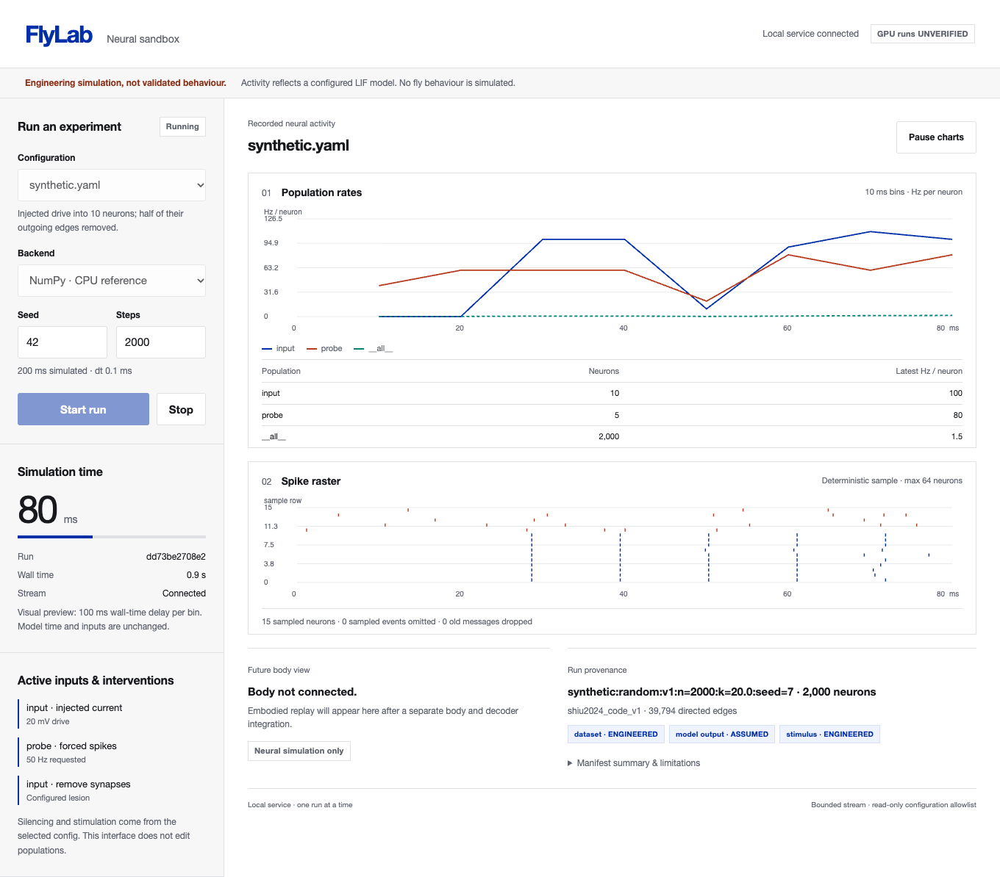

# M7 acceptance report — localhost dashboard (UI mock)

Date: 2026-11-09. Scope: the first static neural dashboard, tested on macOS against the
committed synthetic NumPy configurations. **Engineering simulation, not validated behaviour.**
GPU scientific runs and a body/decoder integration were not executed.

## Gate (spec sections 10, 11.2 and PR-06)

| Criterion | Status | Evidence / scope |
|---|---|---|
| Localhost-only interface | **PASS** | fixed loopback launcher; Host/Origin enforcement; launch/binding test |
| Bounded WebSocket | **PASS** | shared ring, sampled spikes, client/frame/send limits; overflow/backpressure tests |
| Start/stop experiment | **PASS** | real fixture run, cancellation, concurrency test; browser start/finish/stop |
| View rates, raster and interventions | **PASS, synthetic UI mock** | the screenshots and browser record below |
| Manifest, labels and limitations visible | **PASS** | synthetic ENGINEERED dataset, ASSUMED model outputs and parameter labels; manifest panel |
| Security validation | **PASS** | path/allowlist, symlink, overrides, actual payload bytes, Host/Origin and no-shell tests |
| Embodied replay | **DEFERRED** | explicit placeholder only; separate body/decoder branch, not implemented here |
| GPU / full MaleCNS UI run | **UNVERIFIED** | no remote connection, no GPU run and no full-data execution in this review |

The **UI-mock deliverable passes**. Full embodied M7 functionality depends on the separately
validated body/decoder/replay integration; this report does not claim that gate has passed.

## Browser evidence

Source: [ui-browser-checks.json](evidence/ui-browser-checks.json), written from actual
Playwright interactions with the local service. The config is `configs/synthetic.yaml`,
NumPy, seed 42, dt 0.1 ms, 2000 steps / 200 ms. These are engineering fixture inputs.
The manifest summary in that record carries the actual graph fingerprint, counts, model
parameters, evidence labels, configured stimuli/interventions and limitations.

For the screenshots the launcher used `--demo-pace-ms 100`, explicitly visible in the UI:
this delays wall time between bins and does not change neural time or the simulation inputs.
The pre-existing default local port was occupied, so the preview used loopback port 8766;
no existing service was stopped or changed.

| Screenshot | Observed state |
|---|---|
| [ui-idle.png](evidence/ui-idle.png) | allowed config selection; no invented activity |
| [ui-running.png](evidence/ui-running.png) | actual synthetic rate curves, sampled spikes, active inputs/lesion and provenance |
| [ui-finished.png](evidence/ui-finished.png) | completed simulation; bounded plots retained |

All three PNGs are below 300 KB each. Their contents were visually inspected.



The browser record also verifies keyboard skip-link focus, chart pause/resume, reconnecting
to a finished run and cooperative Stop. Widths 375, 768, 1024 and 1440 CSS pixels have no
horizontal overflow. No browser console/page errors occurred in that interaction sequence.
Plots are bounded previews, not a complete spike archive; rates remain available as text.
The interface uses local static assets, labelled form controls, visible focus and a reduced-
motion mode, without a frontend build step or external browser dependencies.

## Executed local checks

macOS, Python 3.12.15, locked runtime/dev/API-test dependencies and the macOS PyPI torch wheel:

```text
uv run ruff check .                                  All checks passed!
uv run ruff format --check .                         113 files already formatted
uv run mypy                                         Success: no issues found in 87 source files
FLYLAB_REQUIRE_API=1 FLYLAB_REQUIRE_TORCH=1 uv run pytest
                                                    387 passed, 10 skipped, 1 warning in 12.58s
node --check src/flylab/api/static/app.js              PASS
uv lock --check                                      Resolved 57 packages
uv build --wheel                                     PASS; all three static assets included
```

The dashboard-specific suite has 39 tests. Its real-run test compares metrics with the
ordinary offline NumPy runner and validates output checksums. The recording hook does not
alter the neural inputs, state updates, experiment config or final result. Cancellation closes
artifact writers and leaves the output incomplete under its `.partial` name.

Core-only mypy was also executed in a separate environment with no torch or API packages:
87 source files pass. A profiler enum lookup from the base branch was made independent of
optional torch stubs so that this check works in both dependency environments.

The single warning is Starlette's deprecation notice for its still-supported `httpx`
TestClient compatibility layer. It does not affect runtime serving. The Linux dashboard
workflow explicitly installs `api` and `api-test` and requires the API tests to import;
core-only CI may skip the optional dashboard suite.

The skips are the PowerShell-dependent redaction check and nine opt-in CUDA tests.
No skipped GPU test is reported as a success.

## Bounds, provenance and limitations

See [DASHBOARD.md](../DASHBOARD.md) for the exact endpoint, allowlist, quota, stream and
network contracts, reproduction commands and the owner's private SSH-tunnel setup.
The neural engine remains independent of the HTTP layer; the experiment runner accepts an
optional Recorder factory and fans out observations alongside the normal artifact recorder.

New runtime dependencies are isolated in the `api` extra (Starlette, Uvicorn, websockets);
HTTP test support is in `api-test`. The lock adds only their dependencies. Every pre-existing
dependency record, version, URL and hash is unchanged; the final package separator gains a
blank line as new alphabetically sorted records follow it. Dockerfile and Compose are unchanged.

Session and per-run budgets are engineering choices. Cancellation/wall/disk checks are
cooperative; dataset loading and artifact finalization are not forcibly preempted. Disk
observation is not a hard filesystem quota. Slow clients can lose old bins and sampled
events; the UI reports that loss. Reconnection can recover only the retained ring.

No real fly rendering, body state, embodied replay, physiological calibration, behavioural
validity, CUDA performance, GPU memory result or remote deployment is claimed. The already
running services on the machine were left alone.
